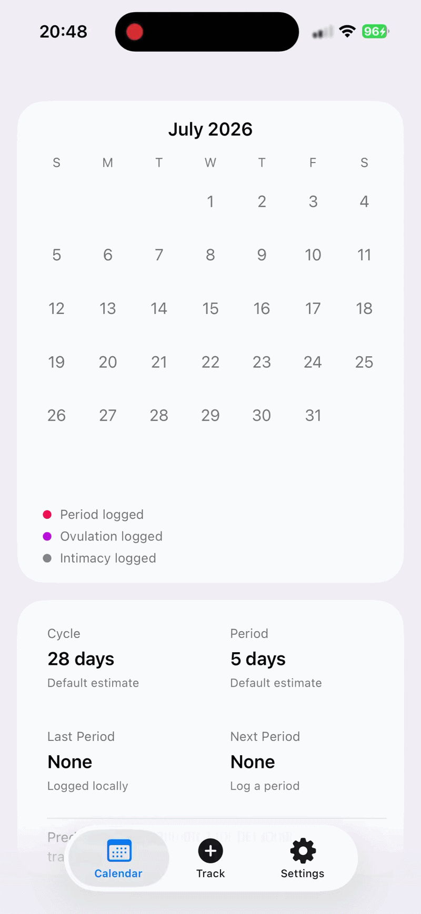

# Ovylune

Ovylune is a private, local-first period and cycle tracker for iPhone and iPad. It requires no account and keeps personal health data on the device—without cloud storage, analytics, ads, or tracking.

<p align="center">
  
</p>

## Features

### Calendar and cycle insights

- Swipe through a monthly calendar showing logged periods, ovulation, and intimacy.
- See estimated upcoming periods, ovulation days, and fertile windows at a glance.
- Review average cycle and period lengths, the most recent period, and the next estimated period.
- Understand prediction quality through confidence levels and irregular-cycle indicators.
- Choose any day of the week as the calendar's starting day.

### Period tracking

- Log completed or ongoing periods with start and end dates.
- Record symptoms and free-form notes with each period.
- Quickly open and update an ongoing period from anywhere in the app.
- Browse, edit, and delete previously logged periods.
- Prevent accidental overlaps with existing period or ovulation records.

### Optional ovulation tracking

- Log single-day or multi-day ovulation events with notes.
- Browse, edit, and delete ovulation history.
- Use logged history to personalize future ovulation and period estimates.
- Enable or disable ovulation tracking from Settings.

### Optional intimacy tracking

- Log intimacy by date with private notes.
- Browse, edit, and delete intimacy history.
- Show logged dates on the calendar when tracking is enabled.
- Enable or disable intimacy tracking from Settings.

### Personalization and privacy

- Add or remove custom symptoms alongside the built-in symptom list.
- Store all period, ovulation, intimacy, symptom, and note data locally with SwiftData.
- Use the app without an account, network upload, analytics, or advertising trackers.
- Permanently clear ovulation or intimacy history when its tracking option is disabled.

## How predictions work

Ovylune starts with general 28-day cycle and 5-day period estimates, then adapts to the history recorded on the device. Recent observations are weighted more heavily, and robust estimates reduce the effect of isolated unusual entries. Confidence and irregularity indicators make the limits of each estimate visible.

Predictions are for personal tracking only. They may not accurately predict periods, ovulation, or fertility.

## Privacy

Ovylune has no accounts, servers, cloud synchronization, analytics, or advertising trackers. Personal data stays in the app's local storage and is not uploaded or shared by Ovylune.

Because there is no cloud backup, deleting the app's data or losing access to the device may permanently erase the recorded history.

## Development

Ovylune is built with SwiftUI and SwiftData.

1. Clone the repository.
2. Open `ovylune.xcodeproj` in Xcode.
3. Select the `ovylune` scheme and an iPhone or iPad simulator.
4. Build and run the app.

Run the test suite from Xcode with **Product > Test**, or from the command line:

```sh
xcodebuild test -project ovylune.xcodeproj -scheme ovylune -destination 'platform=iOS Simulator,name=iPhone 17 Pro'
```

## Disclaimer

Ovylune is not a medical device. Do not use it for diagnosis, treatment, contraception, or other medical decisions. Consult a qualified healthcare professional for medical advice.

## License

This project is licensed under the terms in the [LICENSE](LICENSE) file.
